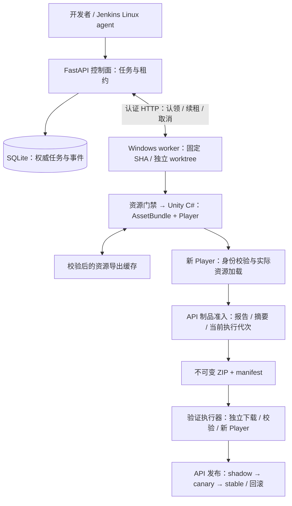
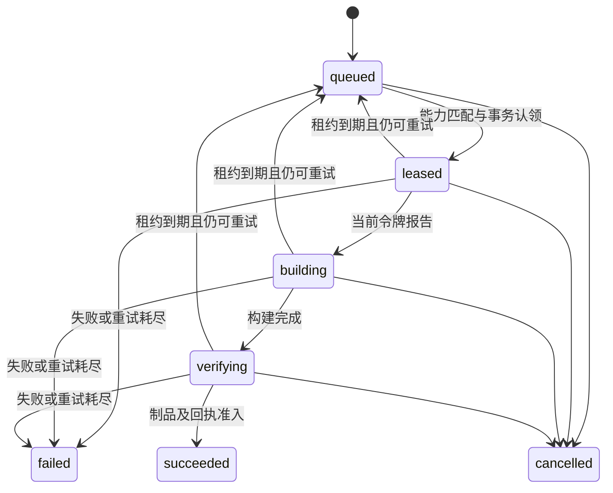
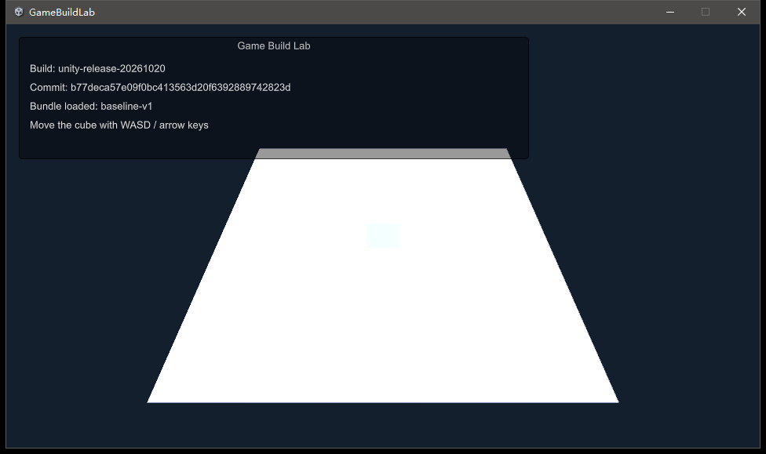

# ForgeRail

**从固定源码到可信游戏包的构建与交付实验平台。**

Game build orchestration, Unity asset validation, immutable artifacts, and executable recovery experiments.

[](https://github.com/Epochex/ForgeRail/actions/workflows/ci.yml)
[](pyproject.toml)
[](unity/BuildLab/ProjectSettings/ProjectVersion.txt)
[](LICENSE)

ForgeRail 将 **Python 控制面、远端执行节点、Unity C# 构建入口和 Jenkins** 串成可追溯的交付链路，处理分支互相污染、资源检查遗漏、旧节点回传、缓存损坏，以及“流水线成功但游戏包不能运行”等问题。

这是可运行、可注入故障的个人工程项目，适合学习游戏构建工程、走读分布式任务机制和验证流水线设计。真实引擎路径是 **Windows x64 / Unity 6000.3.0f1 / Mono**；Python 演示无需安装 Unity。

新增 **[交互式游戏构建工程实验台](docs/interactive-lab.md)**：一个工作台、16 个案例、41 个故障变体。每例均可准备、注入、执行、诊断、修复和复验，查看实际命令、文件差异、阶段耗时、前后断言与可下载证据。此入口不启动 Unity，成功显示“构建成功”及相邻 **Lab** 标识。

安装下方 Python 依赖后，Windows 一条命令打开工作台：

```powershell
./scripts/start-lab.ps1
```

Linux：`.venv/bin/python -m gamebuild.cli lab --open`。默认端口 `18766`，终端打印带本次启动随机凭据的地址；页面使用 HttpOnly 会话。无需 npm、Docker、Jenkins 或 Editor；npm 仅用于开发者运行浏览器验收。

## 目录

- [能力与边界](#能力与边界)
- [系统架构](#系统架构)
- [环境要求](#环境要求)
- [快速开始](#快速开始)
- [运行真实 Unity 构建](#运行真实-unity-构建)
- [Jenkins 与容器实验](#jenkins-与容器实验)
- [发布验证与回滚](#发布验证与回滚)
- [命令与 API](#命令与-api)
- [测试与证据](#测试与证据)
- [目录结构](#目录结构)
- [故障排查](#故障排查)
- [贡献与许可](#贡献与许可)

## 能力与边界

| 领域 | 已实现的机制 |
| --- | --- |
| 固定输入 | 完整 Git SHA、输入摘要、登记仓库、分支独立 worktree；拒绝未声明输入 |
| 多版本并行 | 分支独立工作区、Unity Library 与输出；同机真实双 Editor 并行实验 |
| 资源门禁 | `.meta` / GUID / 大小写 / JSON / 禁入路径；Unity Missing Script、引用与导入设置 |
| 引擎出包 | C# 调用 `BuildAssetBundles` / `BuildPlayer`，嵌入构建身份并实际启动 Player |
| 缓存 | 内容寻址、清单和摘要校验；污染隔离后回退冷构建 |
| 节点治理 | 能力匹配、独占工作区锁、心跳、独立续租、有限重试、执行代次令牌 |
| 制品准入 | ZIP 路径、清单、SHA256、Player 回执与构建身份一致性；不可覆盖提交 |
| 取消与恢复 | 取消/超时终止进程树、陈旧结果拒绝、制品提交中断后重试 |
| 发布 | 影子与灰度观察、绑定制品的回执、渠道指针晋级和回滚 |
| CI 与运维 | Jenkins controller/agent 分离、Windows 节点出包；8 目标 Docker 构建、离线导入、运行身份回读 |
| 消息恢复 | Redpanda 崩溃重放、唯一键去重、stable/shadow 消息与副作用隔离 |

实现边界：单控制面 SQLite、受信任工程、单槽执行节点。同机逻辑节点不代表跨主机集群验收；影子/灰度是本地验证渠道，不接入真实玩家流量。Android、iOS、Unreal、Perforce、k3s 和 systemd 不在已完成的真实构建验收范围内。诊断使用确定性规则，不依赖 LLM 服务。

## 系统架构



控制面保存权威状态，节点负责执行，Jenkins 编排验证与归档。构建成功需要 **源码身份、引擎报告、制品内容和 Player 回执一致**，仅进程退出为零不够。

任务状态主路径：



续租、状态回传和制品提交均核对当前执行代次。旧节点在新节点接管之后回传，即使本地构建成功，也不能发布结果。

可下载 [总览 SVG](docs/assets/overview.svg) 和 [部署 SVG](docs/assets/deployment.svg)。更多图解见 **[架构设计](docs/architecture.md)**：部署拓扑、认领时序、缓存失效、制品事务边界和发布状态机。

## 环境要求

| 层级 | 要求 | 是否必需 |
| --- | --- | --- |
| Python 演示与核心测试 | Python ≥ 3.11、Git，Windows 或 Linux | 基础 |
| 依赖安装 | uv，或 `venv` + pip | 二选一 |
| C# 合约测试 | .NET SDK 9 | 可选，缺失时跳过 |
| Unity 实际出包 | Windows、PowerShell、Unity **6000.3.0f1**、有效授权、Windows Mono 支持 | 引擎路径必需 |
| Jenkins / 镜像 / 消息 | Docker Engine + Compose v2；Windows 使用 Linux containers | 容器路径必需 |

安装脚本要求安装盘至少 **20 GiB** 空间，Editor、多个 Library 与输出还会继续占用磁盘。容器实验额外下载基础镜像和 Jenkins 插件。Editor、license、镜像 tar、游戏包、缓存与凭据不随仓库分发。

## 快速开始

### 1. 获取源码和依赖

```bash
git clone https://github.com/Epochex/ForgeRail.git
cd ForgeRail
uv venv --python 3.11
```

Windows PowerShell：

```powershell
uv pip install --python .venv/Scripts/python.exe -r requirements.lock
uv pip install --python .venv/Scripts/python.exe --no-deps -e .
$python = '.venv/Scripts/python.exe'
```

Linux：

```bash
uv pip install --python .venv/bin/python -r requirements.lock
uv pip install --python .venv/bin/python --no-deps -e .
```

没有 uv 时，执行 `python -m venv .venv`，使用对应虚拟环境解释器运行 `-m pip install -r requirements.lock` 与 `-m pip install --no-deps -e .`。虚拟环境不加入 Git。

发行包名为 `forgerail`，保留 `gamebuild` CLI 和导入路径，方便沿用构建协议和脚本。

### 2. 无引擎演示

Windows：

```powershell
& $python -m gamebuild.cli demo --root runtime/demo --report reports/demo.json
```

Linux：

```bash
.venv/bin/python -m gamebuild.cli demo --root runtime/demo --report reports/demo.json
```

命令创建两个真实 Git 分支、临时 HTTP 控制面和两个节点进程，实际生成、下载并校验小型制品，验证篡改拦截、过期回传拒绝和事件链一致性。成功输出 `status: passed`，证据保存在 `runtime/demo/run-*/`，临时服务随命令结束停止。

**这里使用 `lab` adapter，验证协议、文件和进程行为；不会调用 Unity 或生成游戏 Player。**

### 3. 核心验证

```powershell
& $python -m pytest -q
& $python -m gamebuild.cli doctor --report reports/doctor.json
```

Linux 替换解释器路径即可。缺少 .NET / Editor 时相应测试明确跳过，跳过不算引擎验收。GitHub Actions 的 Windows / Linux CI 运行核心和可用的 .NET 合约测试，不下载或激活 Unity。

## 运行真实 Unity 构建

以下步骤在 Windows 工程根目录执行。

### 1. 安装固定 Editor

```powershell
./scripts/install-unity.ps1
```

脚本使用 Unity 官方下载地址，检查 Authenticode 签名与发布者，记录安装包 SHA256，安装到 `runtime/tools/unity/6000.3.0f1/`，不替换系统 Editor。安装包约 4 GB。

新机器需要本人在 Unity Hub 完成有效授权，可用 Locate 指向此 Editor。仓库不分发 license、不代填账号、不绕过授权。详见 [Unity 文档](docs/unity.md)。

### 2. 启动服务与 Windows 节点

```powershell
./scripts/start.ps1
./scripts/start-unity-node.ps1
```

第一条启动 Compose 并生成随机本地凭据；第二条隐藏启动专用节点。已有本工程实例占用端口时，先在其所属目录停止；不要同时从两个 checkout 启动同一个 `gamebuildlab` Compose 项目。

### 3. 提交固定源码

源码必须已提交且工作区干净。报告若受 Git 跟踪，运行后也会使工作区变脏；先检查 `git status --short`，再决定提交，或在独立干净 clone 中提交任务，不要无意提交凭据。

```powershell
$env:GAMEBUILD_TOKEN = (Get-Content .runtime/credentials.json | ConvertFrom-Json).token
& $python -m gamebuild.cli submit --url http://127.0.0.1:18981 `
  --project buildlab --repo . --adapter unity --wait `
  --report runtime/unity-job.json
```

节点从登记仓库获取完整 SHA，建立 worktree，核对输入摘要，执行资源检查、AssetBundle 导出、Player 构建与无图形冒烟，最后提交 ZIP。默认 Release / `StandaloneWindows64`。节点上报实际 Editor ProductVersion，版本不符不会认领。

Player 是带平面和方块的小场景，加载实际 AssetBundle，核对 bundle / 配置摘要并生成回执。可视模式显示构建版本，支持 WASD / 方向键移动；无图形冒烟只证明初始化和资源加载，渲染需单独观察。

### 4. 分支与并行

创建资源分支、修改 `unity/BuildLab/Assets/BundleSource/demo-config.json` 并提交，分别通过 `--branch main` 与 `--branch <你的分支>` 提交任务，构建身份和输出应分离。

默认 worker 是单槽，会顺序处理任务。若要实际重叠执行，手动启动两个**不同名称、不同 `--root`** 的 worker，传入相同可信仓库的 `--projects` JSON 映射。每个 Editor 必须使用独立 worktree / Library。历史实测见 [parallel.json](reports/unity/parallel.json)，排队成功不视为并行证明。

## Jenkins 与容器实验

```powershell
./scripts/start.ps1
./scripts/start-unity-node.ps1
./scripts/acceptance-labs.ps1 -Python ./.venv/Scripts/python.exe
```

| 服务 | 入口 | 说明 |
| --- | --- | --- |
| Jenkins | `http://127.0.0.1:18980` | 用户 `labadmin`，密码在 `.runtime/credentials.json` |
| 控制面 | `http://127.0.0.1:18981/health` | 业务 API 需要 Bearer token |
| core / edge | `127.0.0.1:18982` / `18983` | 镜像实验临时使用 |
| Redpanda | Compose 内部 `redpanda:9092` | 不发布宿主端口 |

完整入口依次运行四轮 × 八目标构建、八角色 HTTP 启动、离线镜像导入与运行版本回读、Redpanda 崩溃重放、控制面重启恢复，再触发 Jenkins `gamebuild-lab`。

controller 为零 executor；独立 Linux agent 执行测试和归档，通过 HTTP 向 Windows 节点提交 Unity 作业。默认 `RUN_UNITY=true`，没有可用节点或 Unity 授权时，完整流水线不会通过。手动关闭该参数仅验证 Python 协议路径。

agent 不挂载 Docker socket；Docker 故障实验在宿主执行，CI 校验报告。首次需联网下载镜像、插件和依赖；`-SkipImages` 仅用于已有本地镜像与报告的重复验收。启动脚本返回后服务可能仍在初始化，先确认 Jenkins 登录页和 API health 可用。

停止并保留数据：

```powershell
./scripts/stop-unity-node.ps1
./scripts/stop.ps1
```

只有确定要删除本项目 Jenkins 历史、任务库与消息数据时，才使用 `./scripts/stop.ps1 -RemoveProjectVolumes`。不全局清理 Docker 缓存。更多细节见 [容器与消息实验](docs/labs.md)。

## 发布验证与回滚

制品通过构建准入后进入本地 `shadow → canary → stable`。每阶段要求两个不同验证节点身份、唯一 validation ID 和最小观察窗口，观察绑定制品 ID、SHA256 与运行回执。

Windows 上验证已成功的 Unity 制品：

```powershell
$env:GAMEBUILD_ARTIFACT = '<成功任务返回的 artifact_id>'
@'
import os
from pathlib import Path
from gamebuild.release import validate_release
result = validate_release(
    'http://127.0.0.1:18981', os.environ['GAMEBUILD_TOKEN'],
    os.environ['GAMEBUILD_ARTIFACT'], Path('runtime/release-check'),
    channel='demo',
)
print(result['release']['release_id'])
'@ | & $python -
```

每阶段执行两次新的下载、校验与 Player 启动，共四次，保存回执并晋级。两个身份运行在本机，属于机制演示；共享 token 不提供验证者之间的安全隔离。`lab` 制品只检查演示回执，不代替真 Player 验证。

发布下一版本后，使用该新版本的 release ID 回滚渠道指针：

```powershell
$headers = @{ Authorization = "Bearer $env:GAMEBUILD_TOKEN" }
Invoke-RestMethod -Method Post -Headers $headers `
  -Uri 'http://127.0.0.1:18981/v1/releases/<release_id>/rollback'
```

回滚恢复上一渠道制品引用，不重编译或改写旧包；不代表真实玩家端更新或 CDN 已切换。

## 命令与 API

```text
gamebuild demo       临时服务、双节点与协议故障演示
gamebuild serve      控制面；必须设置 GAMEBUILD_TOKEN
gamebuild worker     登记能力、认领、续租、构建、回传
gamebuild submit     固定干净源码并提交；可等待结果
gamebuild status     查询任务
gamebuild cancel     撤销任务，节点终止本次进程树
gamebuild release    创建发布；晋级需验证观察
gamebuild doctor     环境诊断，不替代引擎授权或出包
gamebuild report     从本地控制面目录导出任务与事件
```

`gamebuild <command> --help` 查看参数。`--projects` 是项目 ID 到可信本地仓库的 JSON 映射，节点不会执行任意客户端指定的远程仓库。等待超时/中断会尝试取消远端任务；取消请求仍依赖服务可达。

| 路径 | 作用 |
| --- | --- |
| `GET /health` | 无认证健康检查 |
| `POST /v1/jobs`、`GET /v1/jobs/{id}` | 创建/查询任务 |
| `POST /v1/jobs/{id}/cancel` | 取消 |
| `POST /v1/workers/heartbeat`、`/v1/workers/claim` | 能力登记、认领 |
| `POST /v1/attempts/{id}/renew`、`/report`、`/artifact` | 续租、上报、制品提交 |
| `GET /v1/artifacts/{id}`、`/{id}/download` | 元数据、包下载 |
| `POST /v1/releases` | 创建发布 |
| `POST /v1/releases/{id}/observations`、`/advance`、`/rollback` | 观察、晋级、回滚 |
| `GET /v1/events` | 事件与哈希链 |

除 health 外均需 `Authorization: Bearer <token>`；完整字段以 [api.py](src/gamebuild/api.py) 为准。当前未实现角色/租户隔离；上传大小限制在 multipart 解析后实施，节点也不是执行陌生代码的沙箱。详见 [安全说明](SECURITY.md)。

## 测试与证据

```powershell
# 核心测试、HTTP 演示及现有报告汇总
./scripts/acceptance.ps1

# 加上全部容器与 Jenkins 验收，须先启动服务与 Unity 节点
./scripts/acceptance.ps1 -FullLabs

# 纯 C# 请求、摘要、回执和缓存合约，需 .NET SDK 9
dotnet run --project tests/unity_contracts/UnityContracts.csproj --configuration Release
```

测试覆盖实际 SQLite 并发、HTTP、Git worktree、文件篡改、进程树与本地 socket。纯 .NET 合约和官方引用程序集编译不代替 Editor / Player 运行。

仓库保留路径脱敏后的 **2026-10-20 历史实验 JSON 与 Player 截图**：

| 实验 | 历史结果 | 证据 |
| --- | --- | --- |
| 引擎与资源检查 | 真 Editor 检查、Release Player、资源加载通过 | [engine-status.json](reports/unity/engine-status.json) |
| 双分支并行 | 两个 Editor 时间重叠约 64.30 秒，工作区与身份分离 | [parallel.json](reports/unity/parallel.json) |
| 导出缓存 | 冷 miss、重复 hit、修改 miss、污染隔离恢复 | [export-cache.json](reports/unity/export-cache.json) |
| Jenkins | 本地 #2 SUCCESS，约 32.6 MB Player ZIP 下载校验通过 | [jenkins.json](reports/labs/jenkins.json) |
| 发布与回滚 | 两个制品、8 次新 Player 执行、回切基线 | [release-validation.json](reports/release-validation.json) |
| 消息恢复 | 每链路 12 条唯一事件、1 次重复投递，副作用隔离 | [messaging.json](reports/labs/messaging.json) |



这些报告来自开源导入前的本地实验历史，其中 source SHA、分支名和本机 Jenkins URL **不是公开 GitHub 提交或在线服务**。路径已脱敏，包和大日志留本地。新 checkout 需重新执行验收，历史 `passed` 不代表本机已经验证。`scripts/summarize.py` 仅汇总 A01–A17，不执行实验，缺证据的项标为 blocked。公开版不含旧企业业务源码及其独立修复实验。

## 目录结构

```text
ForgeRail/
├── src/gamebuild/          # 控制面、节点、源码、制品、发布、诊断
├── unity/BuildLab/         # C#、资源 meta、固定项目配置
├── ci/                    # Jenkinsfile 与初始化
├── infra/                 # Compose、Dockerfile、插件清单
├── labs/                  # 镜像、离线、消息恢复、CI 实验
├── scripts/               # 生命周期、Unity 包装与汇总
├── tests/                 # Python 与可执行 C# 合约
├── reports/               # 脱敏历史 JSON、小型截图
├── docs/                  # 架构、Unity、实验、源码导读
├── .github/workflows/     # Windows / Linux 核心 CI
├── requirements.lock      # 固定 Python 依赖
└── pyproject.toml          # 包元数据和 CLI
```

`.venv/`、`runtime/`、`.runtime/`、Unity `Library/`、下载及构建包均忽略。不需要 Git LFS，也不上传 Editor 或游戏可执行文件。

## 故障排查

| 现象 | 先检查 |
| --- | --- |
| 源码不干净 | `git status --short`；报告与 `.meta` 变更；可在干净 clone 中提交 |
| 任务持续 queued | worker 存活、项目登记、精确 Editor 与目标能力 |
| Editor 失败或无包 | 授权、Windows Mono 模块、磁盘、Editor 日志；不要以 lab 成功替代 |
| 制品拒绝 | manifest、完整身份、引擎报告、bundle/config 摘要和新 Player 回执 |
| 回传/续租 409 | 已取消、过期或代次变化；不得重放旧 token 强行提交 |
| 缓存变慢 | 输入、导出规则、目标变化与污染隔离；冷 miss 是允许的恢复路径 |
| Jenkins 不可用 | 容器就绪、端口、agent、凭据与 Docker Linux containers 模式 |
| 测试跳过 | .NET / Editor 存在性、平台限定与实际 skip reason |

深入阅读：[架构](docs/architecture.md) · [源码导读](docs/code-map.md) · [Unity](docs/unity.md) · [容器实验](docs/labs.md) · [工具模块](docs/utilities.md) · [审阅修复](docs/review-and-fixes.md)。

## 贡献与许可

欢迎通过 [Issues](https://github.com/Epochex/ForgeRail/issues) 报告可复现问题，或提交小范围 PR。先阅读 [贡献指南](CONTRIBUTING.md)，注明平台，并区分协议测试、合约编译和真实引擎验收。

原创源码使用 [MIT License](LICENSE)。Unity、Jenkins 插件、容器镜像、Python 依赖遵循各自上游许可；本项目不授予额外的第三方使用或再分发权。见 [第三方说明](THIRD_PARTY_NOTICES.md)。
