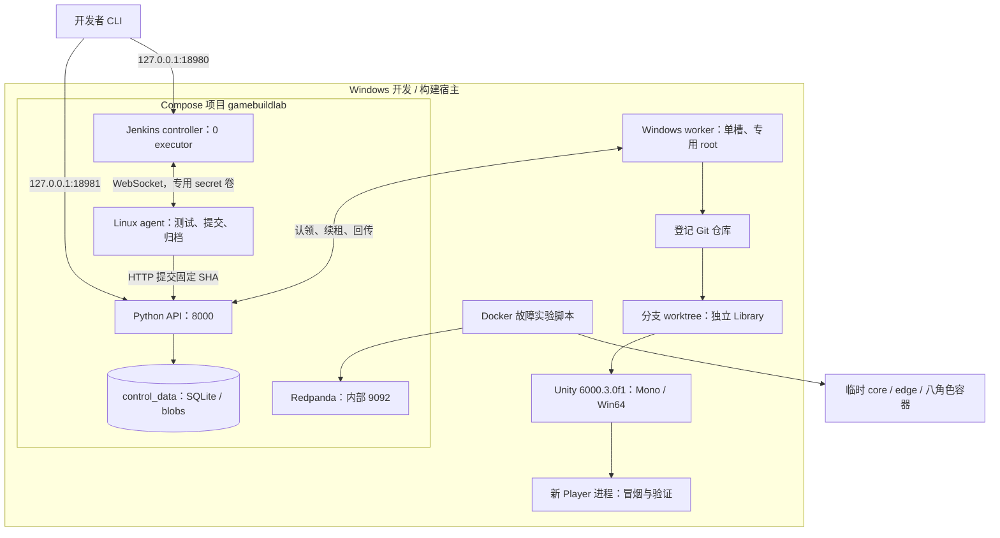
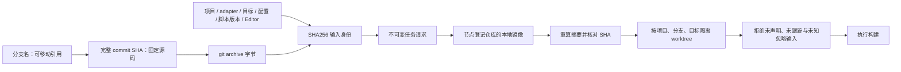
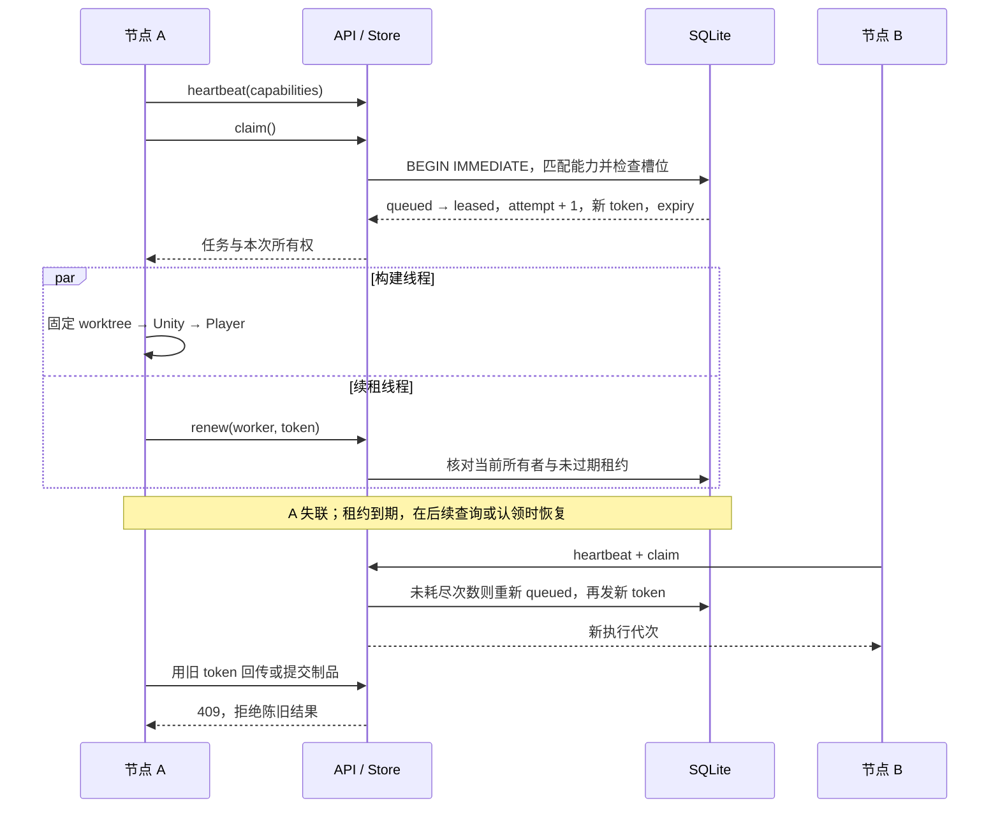
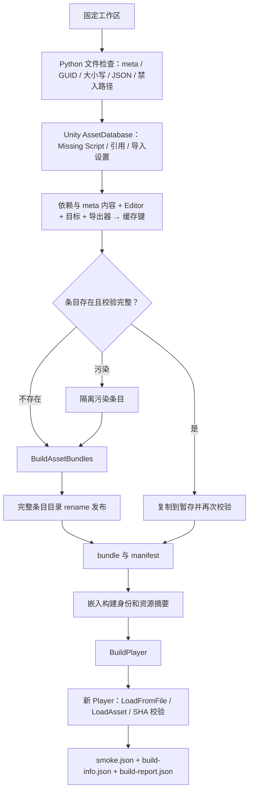
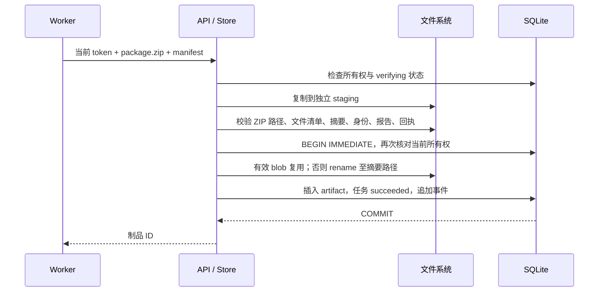
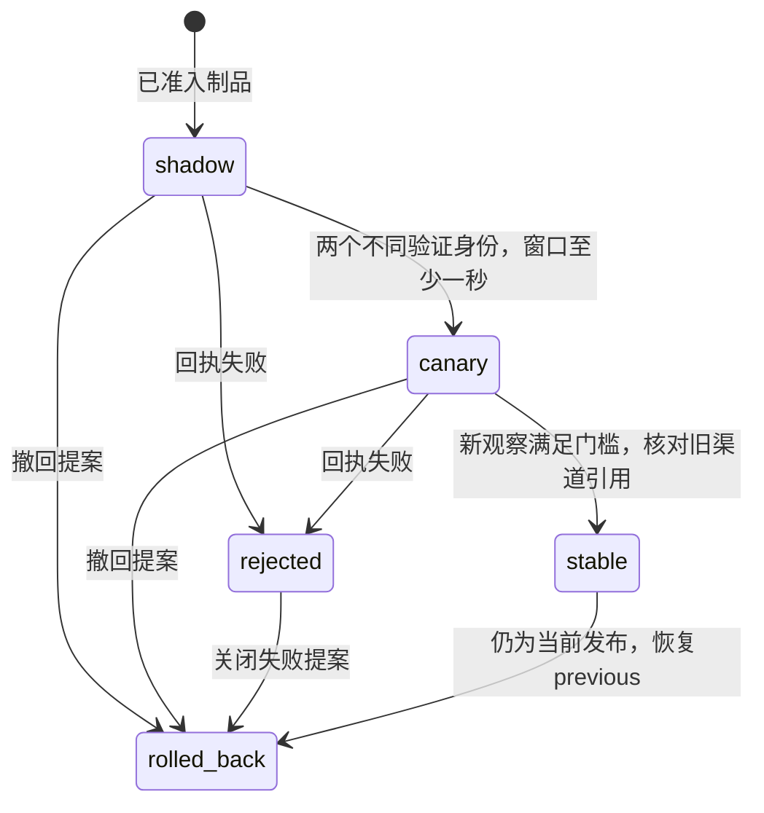
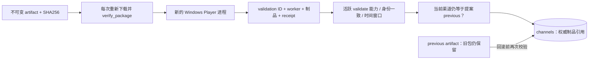
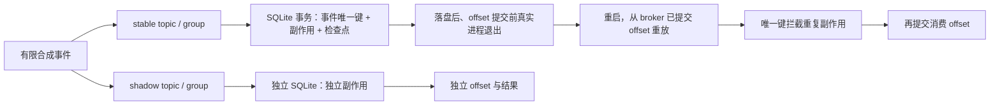

# ForgeRail 架构设计

本文对应当前代码，而不是未来平台蓝图。阅读顺序：部署拓扑 → 固定输入 → 任务所有权 → 引擎与缓存 → 制品准入 → 发布 → 消息恢复。

## 1. 部署与职责

`infra/compose.yaml` 只向宿主回环开放 Jenkins 与 API；Redpanda 不发布端口。Linux agent 不挂 Docker socket。宿主执行镜像/消息故障实验，Jenkins 检查其结果，再进行真实 Windows Unity 作业。

现有启动脚本面向单机 Windows + Linux containers，不包含跨主机发现、TLS 配置或外网 agent 部署。多个节点名字也不意味着多个物理机器。

## 2. 固定输入与工作区

`source.snapshot_request()` 要求提交端工作区干净；`input_digest()` 对 Git archive 与规范化请求配置共同求摘要，分支显示名不作为内容身份。节点只从 `--projects` 登记的可信仓库获取源码，不能由客户端传任意地址。

`SourceManager.prepare()` 维护节点专用镜像和 detached worktree。复用时 reset 到目标 SHA，仅清理声明的生成资源，保留允许的 Library/Temp/Logs 等引擎状态，拒绝额外执行输入。`Library` 不跨 Editor 共享；默认资源导出缓存也在各 worktree 内，可单独配置经过完整校验的共享导出缓存。

代价：当前输入摘要覆盖整个 Git archive，文档/报告提交也可能使构建输入改变；它优先保证完整身份，不是最细粒度的增量构建图。

## 3. 任务认领、续租与陈旧结果

对应 `store.py`：事务使用 `BEGIN IMMEDIATE`，状态为 `queued / leased / building / verifying / succeeded / failed / cancelled`。租约到期最多允许两次认领；显式构建失败直接终止，不会无限自动重试。到期恢复由 `get/jobs/claim` 触发，不是独立常驻调度器。

`worker.py` 的续租线程独立于长时间运行的 Editor。续租失败会设置取消信号，runner 终止本次进程树：Windows 使用 Job Object，POSIX 使用进程组；保留日志有大小上限。常驻 worker 单次任务失败后继续等待，`--once` 则保留失败返回码。

## 4. 资源门禁、引擎出包与缓存

Python 文件检查缓存与 Unity 资源导出缓存是两个层次。缓存命中需要校验清单、文件大小与摘要，复制后再校验；损坏视为 miss 并重新生成。有效同键条目不能被不同内容覆盖。缓存 miss 是正常恢复，不代表构建失败。

Unity C# 入口位于 `Assets/Editor/BuildEntry.cs`，纯合约在 `Assets/Scripts/BuildContracts.cs`。当前使用固定小场景与配置 AssetBundle 验证机制，不模拟大型商业游戏资源量，也不据此推导整体构建加速比例。

## 5. 制品准入与事务边界

验证时不信任调用者仍可修改的原文件。Unity 准入额外要求 Player、真实 bundle、内嵌身份、配置摘要以及成功 smoke 一致；只伪造外层 manifest 不足以通过。

**文件系统和 SQLite 不是同一原子事务。** 文件已移动但数据库提交失败时，可能留下无引用的 blob；任务不能因此被记为成功。重试校验并复用已有正确 blob，再完成数据库提交。当前没有后台孤儿 blob 回收器，也未声明断电级 durability 保证。

## 6. 发布观察、晋级与回滚

`release.validate_release()` 用两个本机逻辑验证身份，各阶段实际运行两次 Unity Player。Store 校验回执并拒绝失败；仅 `advance(passed=true)` 不能越过观察门槛。晋级 stable 前再次检查当前渠道是否仍等于创建提案时的 previous，防止并发发布覆盖；已被更新发布替代的 stable 版本不能回滚并覆盖当前渠道。

共享凭据下的观察是可信执行者协议，不是对恶意验证节点的远程证明。当前至少一秒的窗口用于验证机制，不是推荐的生产灰度时长。渠道指针存在本地 DB，不代表 CDN、补丁服务器或玩家分组已部署。

## 7. 消息重放与影子隔离

投递语义允许重复，由本地唯一键保证实验中的业务副作用不重复。检查点用于观测，不用于跳过尚未提交到 broker 的消息。该实验不证明跨数据库/外部服务的全局 exactly-once。

## 8. 模块与验证对应

| 设计约束 | 实现 | 验证入口 |
| --- | --- | --- |
| 固定身份与工作区输入 | `source.py` | `test_worker.py`、`test_review_regressions.py` |
| 租约、代次、有限重试 | `store.py` | `test_store.py` |
| 进程取消与常驻节点继续 | `runner.py`、`worker.py` | `test_runner.py`、`test_live_cancellation.py` |
| 资源准入与缓存恢复 | `checks.py`、`cache.py`、C# Editor | `test_checks.py`、`test_cache.py`、Unity 实验报告 |
| 制品内容与报告一致 | `artifacts.py`、`store.py` | `test_artifacts.py`、`test_review_regressions.py` |
| 发布观察绑定 | `release.py`、`store.py` | `test_store.py`、历史真实 Player 验证报告 |
| 容器与消息行为 | `labs/` | `acceptance-labs.ps1` |

进一步阅读 [代码索引](code-map.md)、[Unity 实际执行](unity.md)、[CI 与消息实验](labs.md)。历史报告的来源与公开版的验证范围见 README；报告成功状态不代替当前 checkout 的新验收。
