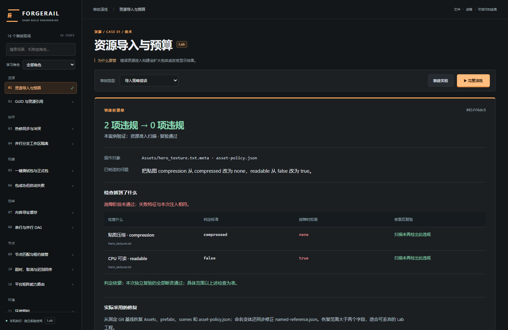

# ForgeRail 能证明什么

本项目是本地构建工程实验平台。当前运行链是确定性 Python/Git/HTTP 任务，没有大模型自主规划或自主修复，因此没有可报告的 Agent 成功率。其价值是把构建问题变成可重现的输入、失败判据、修复动作和独立复验结果。

## 2026-10-23 本机验证记录

- 固定回归集：**41/41 通过**，失败/跳过/缺测/重复均为 0。批次 `20261023T100845Z-a35dcf98`，Windows 10、Python 3.11.15，代码在执行期间保持稳定。191.22 秒是测试耗时，不是构建性能改善数据。
- [归档评测报告](assets/lab-evaluation-2026-10-23.json)：包含全部 41 项结果与源码/JUnit SHA256。此批测量时尚有工作区改动，因此记录 Git 基线及 dirty=true；确切内容由源码指纹标识。
- Python API、计分规则、中断恢复、证据及预算观测回归：17 passed；纯前端观察投影回归：3 passed。
- 浏览器首次完整 24 项通过；新增失败复验测试后，全量结果为 24 passed / 1 failed，暴露超预算错误没有具体字节数。修正后对新手理解与失败复验两项补测，2 passed，25 个已登记浏览器用例均取得通过证据。没有把这次补测改写成一批 25/25 的原始成绩。
- 独立代码审查发现的失败复验隐藏、历史缺测崩溃、可信度限制被折叠三项问题均已修正；前两项有失败后转通过的回归测试，限制文本在折叠状态下常驻可见。它属于工程代码审查，不计作评测样本的人工复核。

原始本机输出位于 `runtime/ux-contracts-final.log`、`runtime/ux-unit-final.log`、`runtime/ux-e2e-final.log`、`runtime/ux-focused-final.log` 及批次目录。页面仍可查看用户原来的历史 run，无需重新制造一份成功结果。

远端 [CI 39937829980](https://github.com/Epochex/ForgeRail/actions/runs/39937829980) 对代码提交 `c1d4714056b9054cc04837d1560553ac65aa570a` 验证：Ubuntu 176 passed / 3 skipped，Chromium 25 passed，前端观察投影 3 passed。Windows 首轮 174 passed / 2 skipped / 3 failed，失败项均为已有 .NET/PowerShell 入口契约的子进程超时；未运行 Unity。本机原样复测这三项 3 passed / 1 references check skipped（6.01 秒），未修改代码或超时阈值，仅重跑失败的 CI 作业，得到 Windows 177 passed / 2 skipped（233.96 秒），HTTP worker 演示也通过。相同提交复跑通过不能证明首次超时的具体环境根因，初次失败记录保留，不能把它声称为首跑全绿。

## 效果如何判定

每个故障变体是一个样本，固定 16 类、41 个变体。执行 `python scripts/evaluate_lab.py --root runtime/interactive-lab` 后，脚本调用 `tests/test_lab_scenarios.py::test_every_variant_closes_real_loop` 的完整参数集。没有挑选成功历史，也没有自动重试取最好值。

每个样本必须同时满足：

1. 实际注入输入变化后，至少一个检查失败。
2. 失败特征与指定故障相符；无关异常不能当作复现。
3. 修复真正改变 fixture 输入摘要。
4. 再次执行后全部断言通过，且观察值发生变化。
5. 场景专属条件满足，例如独立进程 PID、租约 attempt 递增/旧回传 409、子进程与心跳停止、回滚后下载启动、独立增量客户端内容一致。

固定回归通过率 = 通过样本数 / 41。失败、跳过、缺测不计入通过，重复条目无效。一次全通过只能称为“该版本、该环境、本批 41 个已知故障回归通过”，不能叫生产可靠性或未知故障解决率。样本不是随机独立抽样，因此不给出具有总体泛化含义的统计置信区间。

报告保存于 `runtime/interactive-lab/evaluations/<batch_id>/`，包括 `report.json`、`results.xml` 和 `pytest.log`。每批单独留存。页面显示最新完成批次及总批次数，包含代码指纹、Git HEAD/工作区变更状态、平台、Python 版本、每个样本状态和 JUnit 摘要；代码或受跟踪依赖描述变化后标为旧成绩。未生成报告时不显示成功率。

这套 41 样本测试直接调用场景执行契约，**不覆盖浏览器交互和完整服务生命周期**。另外的 Playwright E2E 覆盖 16 个默认事故的六步 API/页面流程，以及变体切换、取消、刷新、证据下载、失败复验显示等行为；Python API/进程测试验证鉴权、幂等、恢复与清理。各类测试分开报告，不能把通过数量相加当成独立业务样本数。

## 评测集来源与偏差

样本和判定规则由项目维护者根据岗位职责及可实现的故障机制人工构造。覆盖维度包括资源、分支协作、构建/启动、缓存/并行、节点/取消、环境/网络、制品/发布/增量和平台路由。包含损坏缓存、迟到回传、错误版本、遗漏闭包等异常路径，但不代表已经覆盖真实团队的全部长尾故障。

没有生产事故采样数据，没有发生频率权重，没有独立外部标注集，也没有盲测留出集。实现、故障生成、修复与断言同源开发，存在自证偏差。这里没有模型训练，训练数据重叠不适用；开发者对评测样本的了解仍会限制结果的推广性。

后续可冻结现有回归集，再由不参与实现的人根据公开规则设计未知扰动，增加负对照（合法输入不得误报）与复合故障，独立评审后形成留出集。不能把这项未来计划写成已经完成的成果。

## 人工复核

尚未开展人工复核，没有复核一致率。自动断言、代码审查和浏览器回归不等于人类对每个样本独立标注。

若开展复核，先冻结规则、样本和证据版本。两名评审分别标注“指定故障是否被识别、修复是否改变正确输入、复验是否足以支持结论”，保存各自原始判断，最后才讨论分歧。报告逐项一致数/双标样本数、分歧原因和仲裁记录；不能先对齐答案再计算一致率。该流程尚未执行。

## 追溯、归因与回放

`run_id → action_id → 输入差异 / 命令退出码 / 检查结果 / 证据 SHA256` 构成查询链。诊断回执标记 `method=rule-based`，引用产生异常的 `source_action_id`，保存实测 observations、注入操作及修复范围。它是规则诊断，不是 Agent 的推理轨迹。

页面把“故障输入是什么”“哪条规则不满足”“恢复了哪些输入”“复验实际测到了什么”放在同一张事故处理单。失败复验保留坏值和新增违规；历史记录缺测明确写缺测。原始命令、完整差异和实际耗时按需展开，导出保留未去重的原始事件。

历史查看是查看已保存证据；完整演练是在新工作空间重跑。进程 PID、端口、时间戳、UUID 可能变化，应比较不变量和摘要，不能要求每一字节运行记录相同。SHA256 支持内容核对，不构成第三方签名或外部可信认证。

## 是否真的有效

目前能验证的是：给定这批已知故障，规则是否正确拦截、指定修复是否能恢复、执行机制是否保留可追溯证据。尚未验证的是：新手是否学得更快、团队工时下降多少、线上故障率下降多少、陌生项目中的泛化效果。需要真实用户任务实验或上线前后对照数据，才能回答这些业务收益问题。

所有结果限定为 Lab：无 Unity Editor/Player、无真实 SDK 构建、无真机验证。环境/平台部分使用显式 fixture 策略；Python 编译和通用 ZIP 只能证明对应工程机制。

## 本次开发取舍

保留模块化单体和原生 ES modules，增加独立的教学内容与纯观察投影，而不是更换框架。执行结果继续由后端负责；前端只能解释已经观察到的内容。`walkthrough.py` 定义 16 个案例的对象、注入、门禁和修复范围，`observations.js` 统一处理失败复验、新增违规和历史缺测，`evaluation.py` 管固定分母与版本指纹。

优点是复用原有运行机制、减少引入新故障，并使新增场景沿“执行器 + 说明 + 判据”扩展。成本是教学说明需要随实现维护、规则诊断对未知问题能力有限、SQLite/本机运行并不等价于生产集群。这里没有足够事实声称采用了米哈游内部架构或 DDD。
