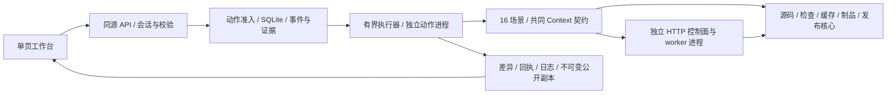

# ForgeRail 交互实验台：开发演进与取舍

## 解决什么问题

把构建工程中“源码改了什么，为什么构建失败，修复凭什么有效”的链路变成可操作、可回看的实验。使用者可以完整经历失败，而不是只看成功流水线；同一个故障有修改、日志、断言、修复差异和复验结果。16 个案例以共用执行契约串起来，覆盖资源、版本协作、构建、缓存、节点、环境、制品与发布。

本次有效性的证据来自本地自动化实验：每个登记变体先出现指定故障，再实际改变输入并通过断言；默认场景由真实浏览器经 HTTP 完成六个步骤。它证明这些条件下的机制和操作闭环，尚不证明生产团队的交付效率、真实游戏性能或企业级可用性。

## 实际架构

采用 **分层的模块化单体、显式状态机、受控进程执行和适配器接口**。FastAPI 与浏览器同源，SQLite 保存权威状态；每个动作由独立 Python 进程执行，复用已有源码、任务、租约、资源、缓存和制品模块。

MVC 有助于理解展示与业务分离，但不足以表达这里的核心难点：动作准入、租约、进程生命周期、制品身份和失败恢复。当前模块按业务能力组织，应用服务协调步骤，底层实现封装 Git、HTTP、文件和 SQLite。领域概念已经明确，暂未引入完整 DDD 的聚合仓储体系或微服务边界。

此选择根据本项目的规模、已批准需求和现有实现作出。没有证据可以据此推断米哈游内部采用相同架构或 DDD；实验覆盖的是招聘岗位涉及的问题。

## 演进过程

| 阶段 | 形成的能力 | 为什么这样推进 |
| --- | --- | --- |
| 保留原构建核心 | 复用 SourceManager、Store、ContentCache、校验、进程 runner | 原有规则和回归已有价值；先把实验层接入，保持旧 CLI/API 兼容 |
| 建立一条纵向闭环 | Context、动作状态机、SQLite、API 与首个资源案例 | 先确定输入、动作、结果和证据如何贯通，避免 16 套各自定义状态 |
| 按机制增加场景 | 资源/源码/构建/系统四组，共 16 案例、41 变体 | 复用机制，变体表达不同失败原因；每一类都有真实负例与修复 |
| 接入统一工作台 | 原生模块、六步控制、断言对比、日志/差异/计时/历史 | 页面直接读取后端事实，使用者逐步理解因果；展示层不生成成功状态 |
| 通过反例修正设计 | 指定故障识别、文件/Git 检查点、真实 HTTP 节点、取消传播 | 第一轮能跑通不代表足够可信；独立审查和故障测试暴露了更深的边界 |
| 固化验收与分发 | Python/浏览器回归、Windows/Linux CI、wheel 包含 UI | 后续修改能重复证明闭环仍成立；使用者安装 Python 依赖即可启动 |

这是逐步扩大范围的纵向迭代，同时保留旧核心的渐进重构。测试先给出缺失行为或失败样本，再增加实现；独立审查按设计要求寻找反例，修复后补回归。界面与共享机制分工清楚，最终通过真实 HTTP/浏览器重新组合验收。

## 审查真正改变了什么

- **指定失败的证据**：最初只判断 aggregate `passed=false`，独立审查把缺失资源案例的代码改成语法错误，发现也会推进为“已复现”。新增按案例/变体的故障识别；其他失败保留为执行失败，不能进入诊断修复链。
- **中断后的输入**：仅把 RUNNING 标记为 INTERRUPTED，无法撤销已发生的资源重命名。新增变更动作前的 fixture/Git 检查点，重试先恢复上次边界。原始失败与恢复后的执行分别留痕。
- **真实节点边界**：最初队列使用短生命周期 HTTP facade，但任务执行仍由场景协调。现在 05/09 复用原 API 和 `work_once`，控制面与节点分别运行在进程内，实际上传、准入并下载制品。节点由受控 builder 编译/测试，运行回执由另一个进程写出。
- **取消不能止于父进程**：动作、HTTP worker、构建子进程跨多个进程组。取消标记、父进程监测、软期限与强制终止宽限配合，使内层先回收；Windows 还沿用 Job Object。专门回归覆盖真实运行期间取消，POSIX 服务死亡路径交由 Linux CI 验证。
- **可下载证据**：原始数据库和内部凭据不作为公开证据；文本先脱敏再登记不可变副本，下载摘要与登记摘要一致。UI 的“复现”“成功”横幅同时核对动作状态和实测结果。

## 主要取舍

| 选择 | 收益 | 代价与扩展条件 |
| --- | --- | --- |
| 单控制面 + SQLite | 启动简单、事务准入明确、便于本地复盘 | 全局两个动作，单写入控制面；多控制面时需数据库级租约、共享存储和调度协调 |
| 独立动作进程 | 单例故障隔离、取消清理、每步独立验证持久化输入 | 启动开销与跨进程契约较多；不适合毫秒级高频任务 |
| 原生 ES Modules | 无应用前端依赖与编译服务，同源一命令启动 | 状态/DOM 更新需手工维护；页面、组件或协作规模扩大后可迁移 React，保留 HTTP 契约 |
| 规则诊断 | 确定、离线、可复现，失败证据直接可核对 | 仅覆盖登记模式；后续 Agent 可检索证据并建议修复，准入仍依赖确定性检查 |
| 文件/Git 全量检查点 | 本地小 fixture 易验证、能够恢复文件与 Git 索引/历史 | 磁盘开销随实验增长；真实大工程应改用不可变输入、独立 worktree、分阶段产物与垃圾回收 |
| 本地 Lab 工作负载 | 快、易造故障、面试可重复操作 | 资源语义、授权/SDK 和通用 ZIP 的结论不能外推到真实引擎与平台 |
| 有限公共契约 | Context/结果/证据统一，新增场景成本可控 | 暂未设计通用工作流 DSL、插件市场或多租户权限，避免为未出现需求维护抽象 |

## 后续如何扩展

新增案例时，登记 catalog、实现准备/注入/执行/修复、添加指定故障证据条件，补每个变体闭环测试及默认浏览器验收。展示依赖统一的 checks/facts/events/evidence，通常无需新增页面。

新增 Unity/其他引擎时，通过受控 builder/执行器适配器接入真实工具，保留构建身份、日志、制品校验和运行回执契约。实际 Editor/SDK/授权验收应独立完成，`execution_mode` 使用实际模式；当前 Lab 结果继续保留原语义。

多人远端使用时，优先补认证授权、项目隔离、资源配额、数据库和对象存储，再评估队列/服务拆分。状态变更仍需事务与执行代次校验；远端超时重试需幂等业务键及陈旧结果拒绝。事件流用于观察和回放，本次权威状态仍来自数据库，不依赖从日志重建。

性能扩展先收集真实阶段分布、队列等待和资源消耗，再决定缓存、并行度或服务拆分。当前计时只能说明本机微型工作负载，不承诺固定加速比。

## 验收记录

最终命令、计数及保留边界见仓库交付记录 `docs/interactive-lab-validation.md`。运行原始证据在忽略的 `runtime/`；持续验收记录由 GitHub Actions 提供。
